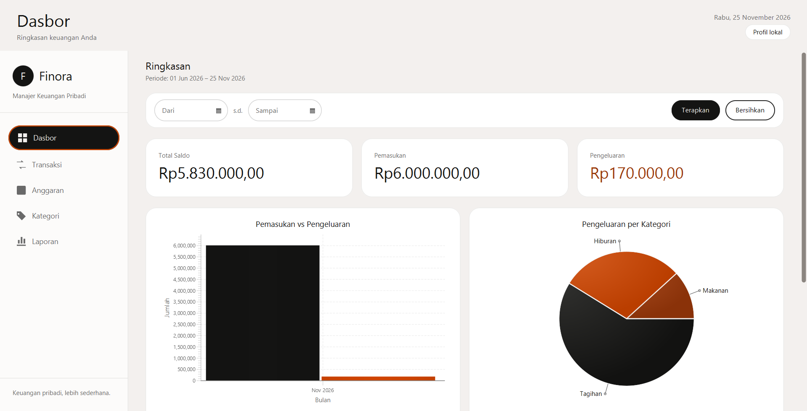
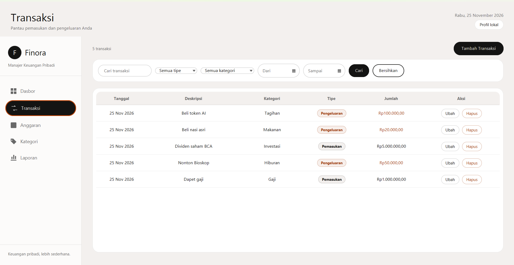
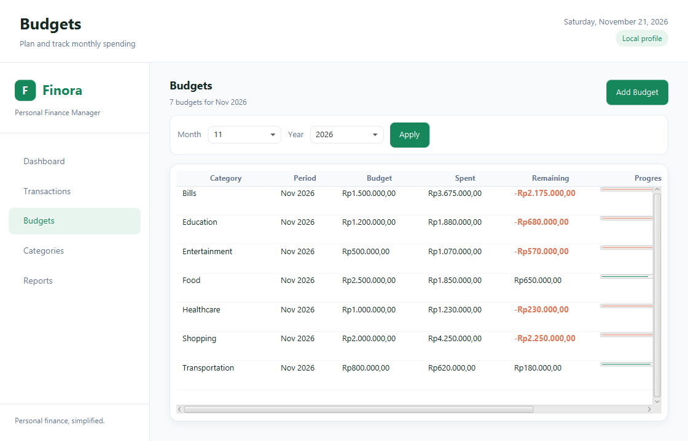
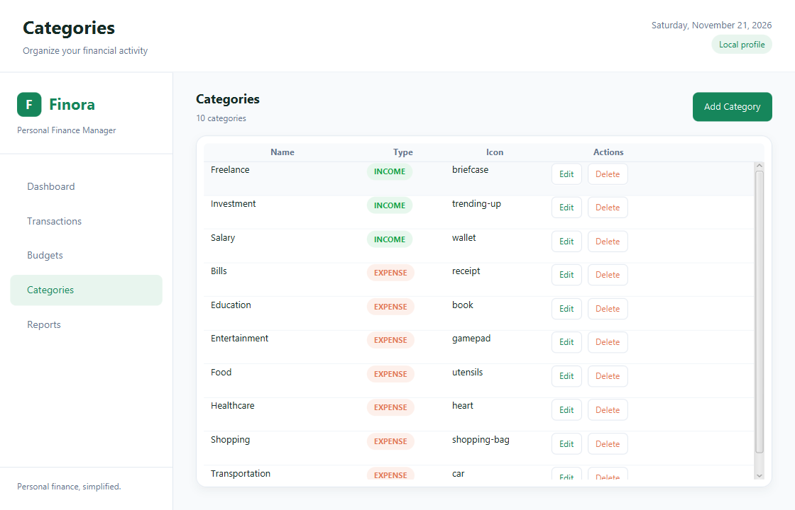
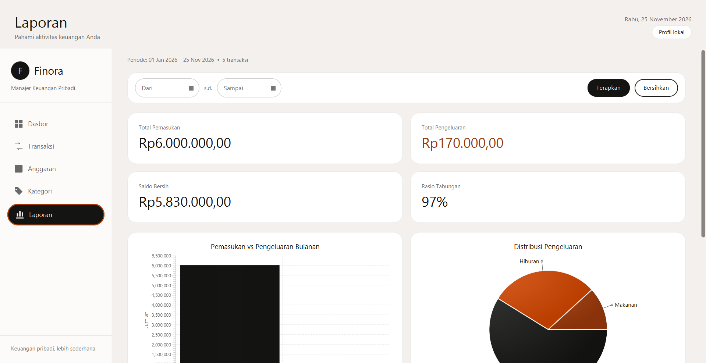

# Finora — Personal Finance Manager

A desktop personal finance manager built with JavaFX and MySQL. Track income and
expenses, set monthly budgets, and understand your spending through a visual dashboard.




## Overview

Finora is a single-user desktop application for managing personal finances.
All data is stored in a local MySQL database, and every financial value is
calculated from real records using `BigDecimal`.

The application interface is in Indonesian and uses IDR (Indonesian Rupiah).

## Design

The interface uses a warm editorial direction rather than a flat dashboard look:

- Canvas cream `#F3F0EE`, lifted surfaces `#FCFBFA`, cards and inputs `#FFFFFF`.
- Primary action is Ink Black `#141413` with cream text; main text `#141413`, secondary `#696969`.
- Signal Orange `#CF4500` is reserved for focus rings and over-budget states.
- Expense and warning text use Clay Brown `#9A3A0A` for AA contrast at body size.
- Radius 20 for buttons, cards, and filter bars; pill radius for inputs and nav items.
- Borders come before shadows; shadows stay on floating surfaces only.

## Features

- **Dashboard** — total balance, income, expenses, income vs. expense chart,
  expense distribution, and recent transactions.
- **Transactions** — add, edit, delete, search, and filter by category, type, or date range.
- **Categories** — organize income and expense categories with safe deletion.
- **Budgets** — monthly spending limits with progress, remaining amount, and utilization.
- **Reports** — period summaries, savings rate, monthly comparison, and expense distribution.

## Screenshots

| Transactions | Budgets |
|---|---|
|  |  |

| Categories | Reports |
|---|---|
|  |  |

> These screenshots show the previous visual version and are being refreshed.

## Technology Stack

| Technology | Version | Purpose |
|---|---|---|
| Java | 21 | Programming language |
| JavaFX | 21.0.5 | Desktop UI |
| FXML | — | UI layout |
| JavaFX CSS | — | UI styling |
| MySQL | 8 | Database |
| JDBC (MySQL Connector/J) | 8.0.33 | Database access |
| Maven | 3.9+ | Build and dependency management |

## Architecture

Finora uses a deliberately simple structure without extra frameworks:

- `config` — JDBC connection.
- `model` — data classes.
- `dao` — SQL queries and CRUD operations.
- `controller` — UI logic.
- `util` — reusable helpers.
- `resources` — FXML and CSS.

## Prerequisites

- JDK 21
- Maven 3.9+
- MySQL Server 8 (and optionally MySQL Workbench)

Verify your setup:

```bash
java -version
mvn -version
```

## Getting Started

### 1. Clone the repository

```bash
git clone https://github.com/MadeRama21/Finora-Personal-Finance-Management.git
cd Finora-Personal-Finance-Management
```

### 2. Create and initialize the database

The database is managed **manually**. The Java application never creates or
modifies the schema, so these steps must be run by hand once.

#### 2.1 Create the database

Open MySQL Workbench (or the `mysql` CLI) and execute:

```sql
CREATE DATABASE finora_db
    CHARACTER SET utf8mb4
    COLLATE utf8mb4_unicode_ci;
```

#### 2.2 Run the setup script

Select `finora_db`, then run:

```text
database/finora_db.sql
```

The script creates the following objects:

| Object | What it contains |
|---|---|
| `categories` | Income and expense categories (`INCOME` / `EXPENSE`) |
| `transactions` | Financial records: category, amount, description, date |
| `budgets` | One monthly limit per expense category (`UNIQUE (category_id, month, year)`) |
| Default data | 13 starter categories (5 income, 8 expense) |

Default categories inserted by the script:

- **Income:** Salary, Freelance, Business, Investment, Other Income
- **Expense:** Food & Beverage, Transportation, Shopping, Entertainment,
  Health, Education, Bills, Other Expenses

You can rename, add, or delete categories later from the **Categories** page.

#### 2.3 Verify the setup

Run this to confirm everything was created:

```sql
USE finora_db;
SHOW TABLES;
SELECT COUNT(*) FROM categories;
```

Expected result: **3 tables** (`categories`, `transactions`, `budgets`) and
**13 rows** in `categories`.

> Run `database/finora_db.sql` only on a fresh database. It creates tables
> without `IF NOT EXISTS`, so re-running it on an existing database will fail.

### 3. Configure the connection

Credentials are read from environment variables, so they never live in source code.

| Variable | Default |
|---|---|
| `FINORA_DB_URL` | `jdbc:mysql://localhost:3306/finora_db` |
| `FINORA_DB_USER` | `root` |
| `FINORA_DB_PASSWORD` | *(empty)* |

**PowerShell**

```powershell
$env:FINORA_DB_USER = "your_user"
$env:FINORA_DB_PASSWORD = "your_password"
```

**Command Prompt**

```bat
set FINORA_DB_USER=your_user
set FINORA_DB_PASSWORD=your_password
```

**macOS / Linux**

```bash
export FINORA_DB_USER="your_user"
export FINORA_DB_PASSWORD="your_password"
```

> Never commit database credentials to Git.

### 4. Run the application

```bash
mvn clean javafx:run
```

IntelliJ IDEA users can also run `com.finora.FinoraApplication` directly.

## Sample Data (Optional)

`database/sample_data.sql` inserts demo transactions for the last three months
and current-month budgets. Every record uses a `DEMO | ` description prefix so
it is easy to identify and remove.

```text
1. Select finora_db in MySQL Workbench.
2. Run database/finora_db.sql on a fresh database (skip if already set up).
3. Run database/sample_data.sql.
4. Restart Finora to see populated charts and tables.
```

If an older database still has `UNIQUE (category_id)` on `budgets`, run
`database/fix_budget_constraint.sql` first. It includes an inspection query so
you can verify the constraint before changing anything.

## Build

Compile and package the project:

```bash
mvn clean package
```

The application is launched through the JavaFX Maven plugin with
`mvn javafx:run`.

## Project Structure

```text
Finora/
├── database/
│   ├── finora_db.sql
│   ├── fix_budget_constraint.sql
│   └── sample_data.sql
├── screenshots/
│   ├── dashboard.png
│   ├── transactions.png
│   ├── budgets.png
│   ├── categories.png
│   └── reports.png
├── src/main/
│   ├── java/com/finora/
│   │   ├── FinoraApplication.java
│   │   ├── config/
│   │   ├── controller/
│   │   ├── dao/
│   │   ├── model/
│   │   └── util/
│   └── resources/com/finora/
│       ├── css/
│       └── fxml/
├── LICENSE
├── README.md
└── pom.xml
```

## Database Schema

Full column-level details summary:

| Table | Key columns |
|---|---|
| `categories` | `id`, `name`, `type`, `icon` |
| `transactions` | `id`, `category_id` → `categories`, `amount`, `description`, `transaction_date`, `created_at` |
| `budgets` | `id`, `category_id` → `categories`, `amount`, `month`, `year` |

## Troubleshooting

| Problem | Solution |
|---|---|
| `Communications link failure` | Make sure MySQL Server is running and the URL/port are correct. |
| `Access denied for user` | Check `FINORA_DB_USER` and `FINORA_DB_PASSWORD`. |
| `Unknown database 'finora_db'` | Run `database/finora_db.sql` in MySQL Workbench. |
| JavaFX runtime error on launch | Confirm JDK 21 is active and run through `mvn javafx:run`. |
| Budget with the same category/month rejected | Apply `database/fix_budget_constraint.sql` to allow one budget per month. |

## Project Status

Version 1.0 is complete: all roadmap phases are finished, covering Categories,
Transactions, Dashboard, Budgets, and Reports.

The MySQL database remains managed manually. Finora only connects to an existing
`finora_db` through JDBC and never alters its schema.

## License

Released under the [MIT License](LICENSE).

## Author

**Dwija** ([@MadeRama21](https://github.com/MadeRama21)) — created as an
educational project for learning Java, JavaFX, and JDBC.
